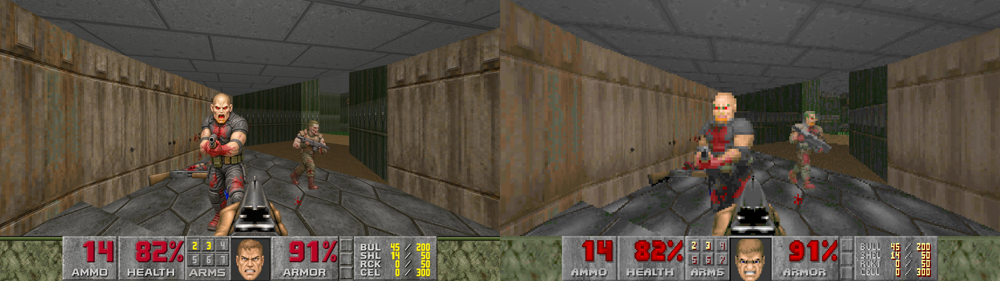
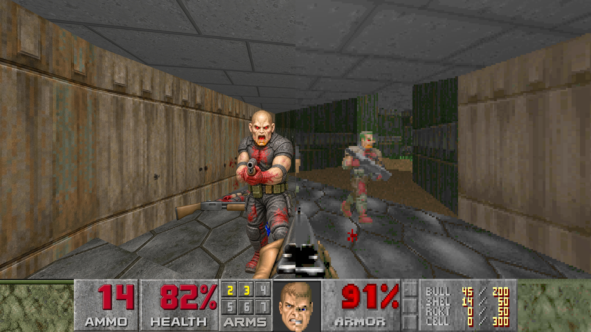
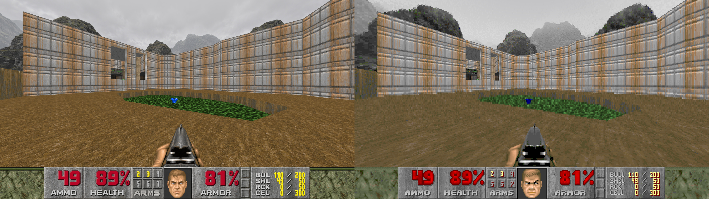
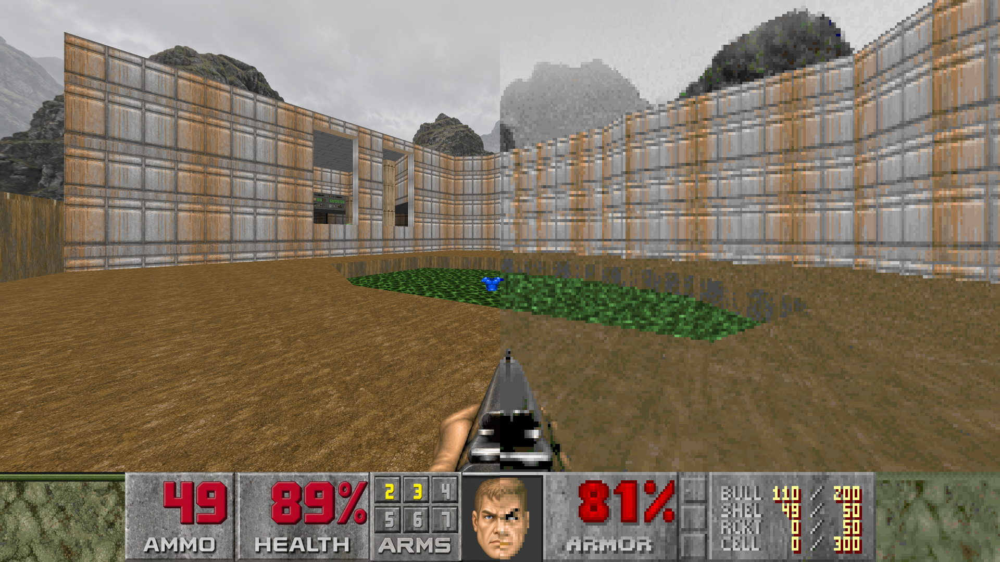
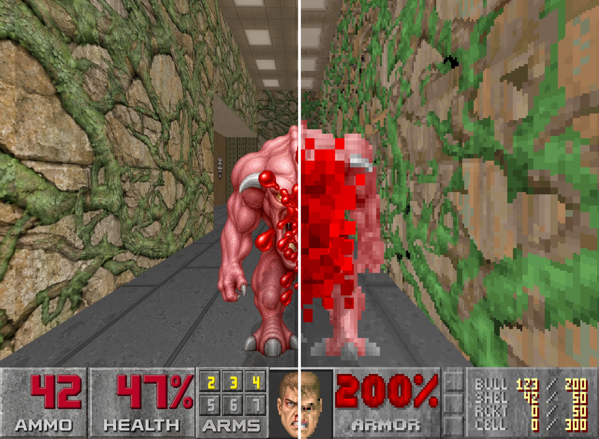
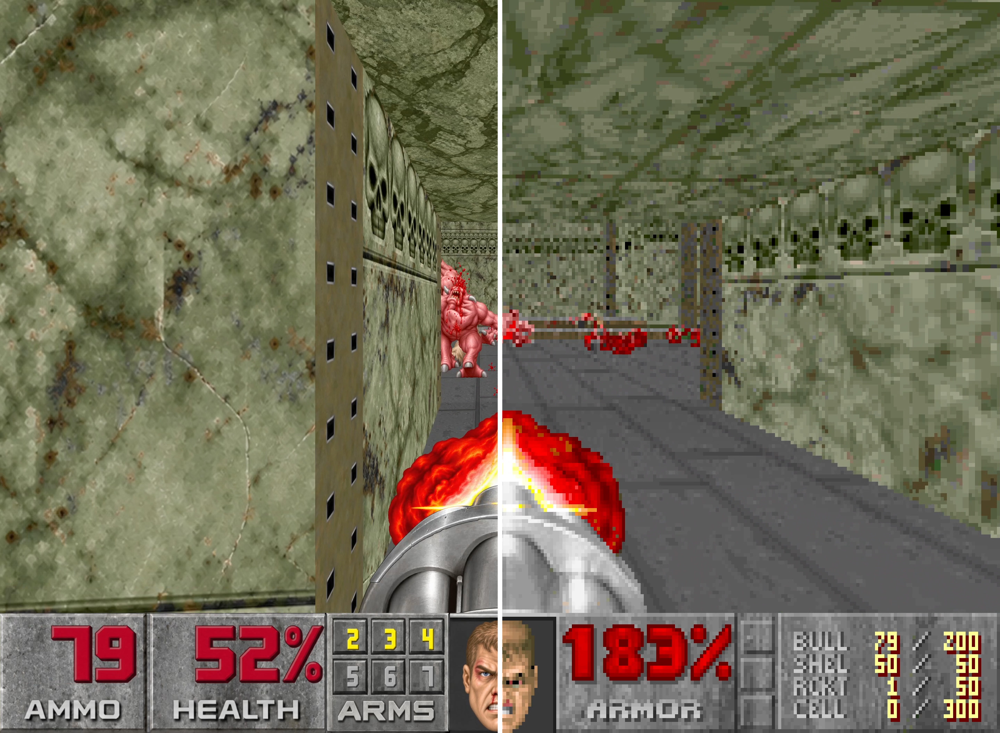
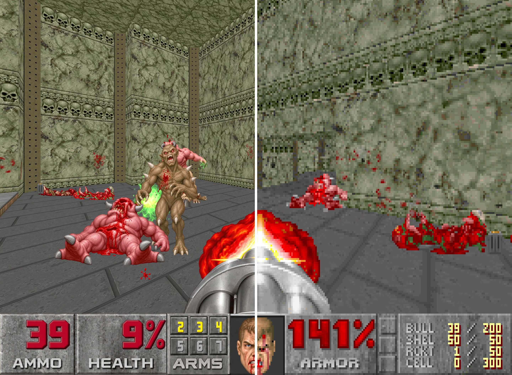
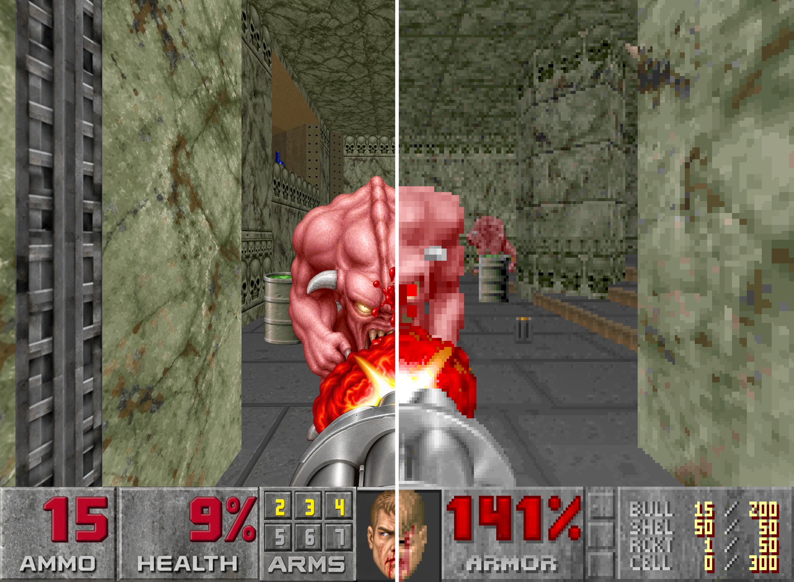

# Doom4K

A Windows release of Doom I with the project's active high-resolution visual packages and a portable GZDoom runtime. The game WAD is not included.

## Download and play

1. Download `Doom4K_Windows_v03.zip` from the [latest release](https://github.com/SalmeInMotion/Doom4K/releases/latest).
2. Extract the complete archive to a writable folder.
3. Copy a legally owned full Doom I IWAD into the extracted folder and name it `DOOM.WAD`.
4. Run `Play Doom 4K.cmd`.

The shareware `DOOM1.WAD` is not supported: GZDoom blocks mods when it detects a shareware IWAD. The full campaign content comes from the IWAD supplied by the player.

## What's included

The Windows release contains `gzdoom.exe`, the runtime files required by that build, the active 13-package Doom4K visual stack, a portable configuration, and the launch script. No Doom game WAD is included. The release ZIP has a SHA-256 manifest.

## Visual comparison

Each example shows the same captured game state in both artwork modes. The side-by-side image places HQ on the left and Original on the right; the split image uses the F9 half-and-half comparison.

| HQ vs Original | F9 split-screen |
|---|---|
|  |  |
|  |  |
## Gameplay demo comparisons

F9 split-screen captures show the HQ rendering on the left and the original low-resolution artwork on the right.

| Gameplay frame 1 | Gameplay frame 2 |
|---|---|
|  |  |
|  |  |
## Source

The `engine-source/GZDoom` directory contains the corresponding GZDoom source used for the included Doom4K runtime build. GZDoom is licensed under GPL-3.0-or-later; see its `LICENSE` and `licenses.zip` for the engine and bundled third-party notices.

## Artwork and game data

The Doom4K packages are fan-made visual replacements derived from Doom game artwork. This repository does not grant rights to the Doom game, its original artwork, trademarks, or any IWAD. The player must supply a legally obtained full Doom I IWAD.

